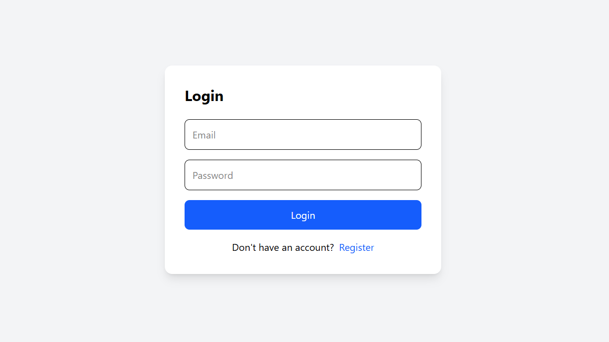
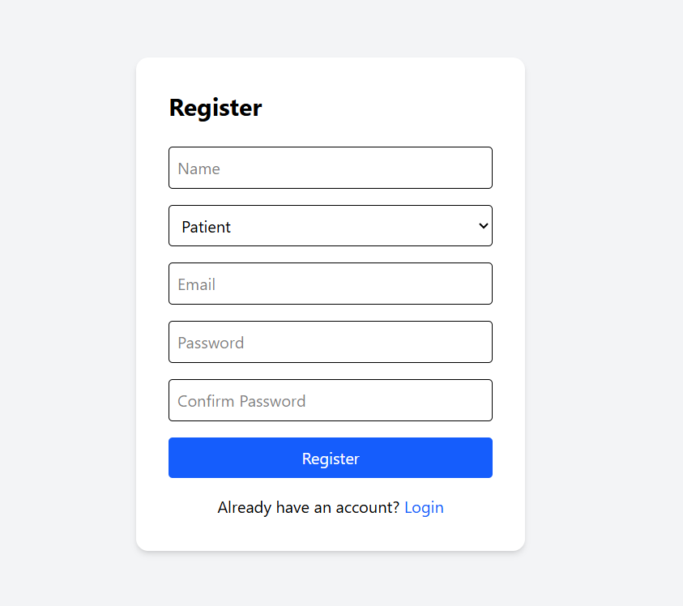
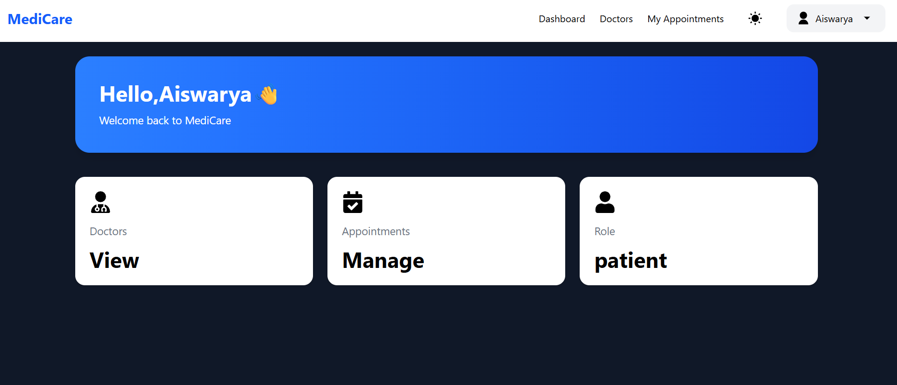
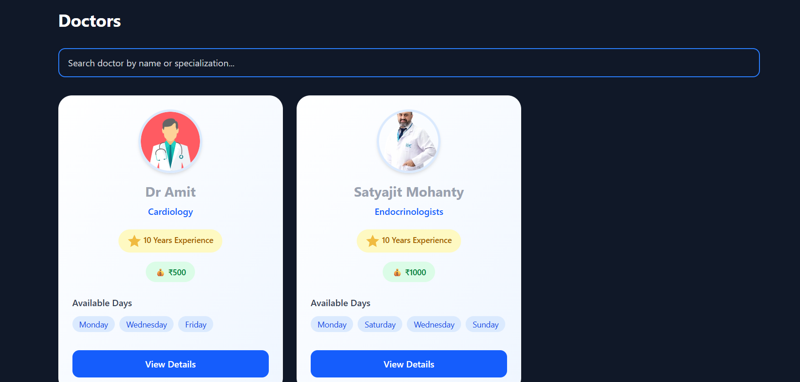
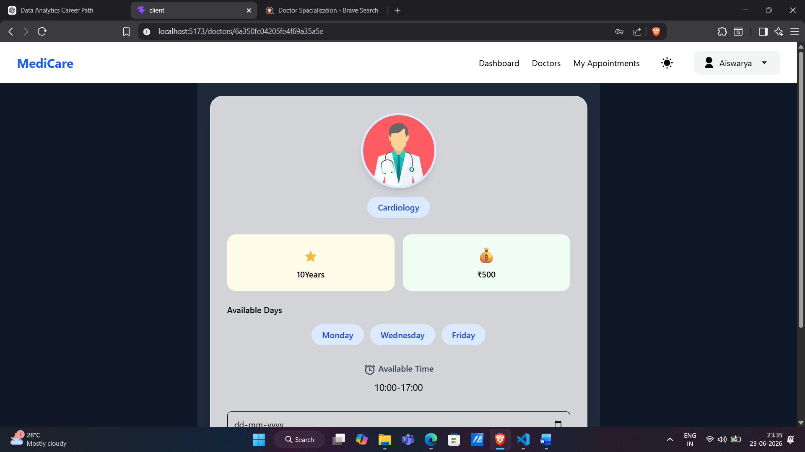
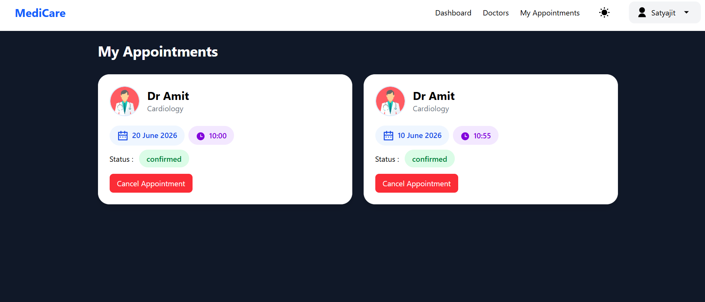
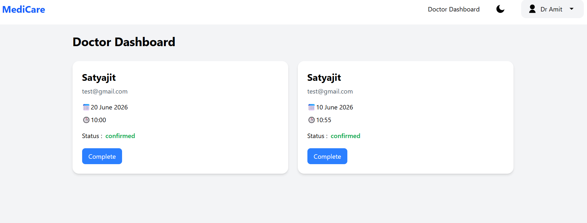
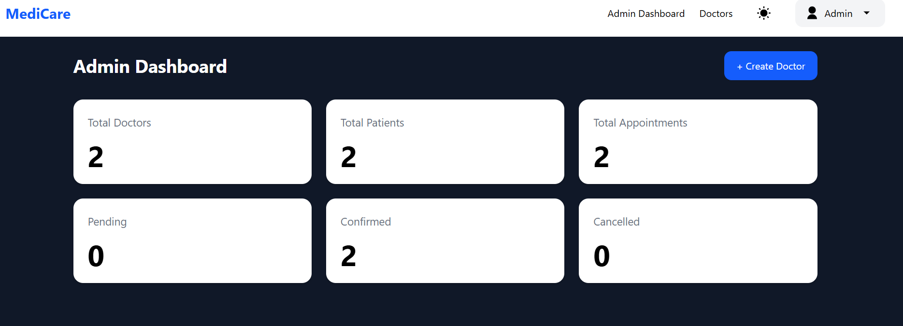
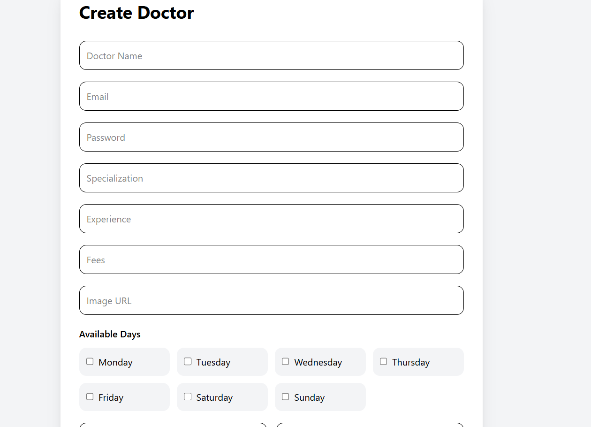

# MediCare – Hospital Appointment Management System

A full-stack hospital appointment management application built to connect patients, doctors, and administrators through an organized appointment scheduling platform.

## Overview

MediCare is a web-based hospital appointment management system developed using React.js, Node.js, Express.js, and MongoDB.

The application provides separate interfaces for patients, doctors, and administrators. Patients can explore doctors and manage appointments, doctors can view and manage their appointments, and administrators can manage doctors and monitor application statistics.

## Screenshots

### 1. Authentication

**Login Page**



**Registration Page**



### 2. Patient Dashboard



### 3. Doctor Listing



### 4. Doctor Details and Appointment Booking



### 5. My Appointments



### 6. Doctor Dashboard



### 7. Admin Dashboard



### 8. Create Doctor



## Features

### Authentication and User Management
- User login and registration interfaces.
- Patient and administrator account access.
- User profile information and logout option.
- Role-based application interfaces.

### Patient Features
- Patient dashboard with account information.
- Browse available doctors.
- Search doctors by name or specialization.
- View doctor profiles, specialization, experience, and consultation fees.
- Check doctor availability.
- Select appointment dates and time slots.
- View and manage personal appointments.
- Cancel appointments.

### Doctor Features
- Dedicated doctor dashboard.
- View appointment information.
- Access patient details associated with appointments.
- Manage appointment status.

### Admin Features
- Dedicated administrator dashboard.
- View total doctors, patients, and appointments.
- Monitor pending, confirmed, and cancelled appointments.
- Create doctor profiles.
- Access administrator profile information.

## Tech Stack

### Frontend
- React.js
- Vite
- JavaScript
- CSS
- React Router

### Backend
- Node.js
- Express.js
- REST APIs
- JWT Authentication

### Database
- MongoDB
- Mongoose

### Development Tools
- Git
- GitHub
- Visual Studio Code
- Postman
- npm

## Project Structure

```text
hospital-appointment-system/
│
├── client/
│   ├── public/
│   ├── src/
│   │   ├── assets/
│   │   ├── components/
│   │   ├── layouts/
│   │   ├── pages/
│   │   ├── routes/
│   │   ├── services/
│   │   ├── App.jsx
│   │   ├── index.css
│   │   └── main.jsx
│   ├── package.json
│   └── vite.config.js
│
├── server/
│   ├── config/
│   ├── controllers/
│   ├── middleware/
│   ├── models/
│   ├── routes/
│   ├── package.json
│   └── server.js
│
├── screenshots/
│   ├── 01-login.png
│   ├── 02-register.png
│   ├── 03-patient-dashboard.png
│   ├── 04-doctors-list.png
│   ├── 05-doctor-details-and-booking.png
│   ├── 06-my-appointments.png
│   ├── 07-doctor-dashboard.png
│   ├── 08-admin-dashboard.png
│   └── 09-create-doctor.png
│
├── .gitignore
└── README.md
```

## Getting Started

Follow these instructions to run the project locally.

### Prerequisites

Make sure you have installed:

- Node.js
- npm
- MongoDB or a MongoDB Atlas account
- Git

### 1. Clone the Repository

```bash
git clone https://github.com/Satyajit799/Hospital-Appointment-System.git

cd Hospital-Appointment-System
```

### 2. Backend Setup

Navigate to the server directory:

```bash
cd server
npm install
```

Create a `.env` file inside the `server` directory.

Example configuration:

```env
PORT=5000
MONGO_URI=your_mongodb_connection_string
JWT_SECRET=your_jwt_secret
```

Replace the example values with your actual configuration. Check your backend source code for the exact environment variable names it uses.

Start the backend using the script defined in `server/package.json`. For example:

```bash
npm run dev
```

### 3. Frontend Setup

Open another terminal and navigate to the client directory:

```bash
cd client
npm install
npm run dev
```

Vite will display the local development URL in your terminal.

### 4. Environment Configuration

Configure the frontend API base URL if your application requires one.

Make sure that:

- The MongoDB connection string is valid.
- The JWT secret is configured.
- The backend is running.
- The frontend API URL points to the correct backend.

**Security:** Never upload `.env` files, database credentials, JWT secrets, or private API keys to GitHub.

## Learning Outcomes

Working on this project helped me gain practical experience in:

- Full-stack web application development.
- Building reusable React components.
- Developing REST APIs using Express.js.
- Integrating MongoDB with Mongoose.
- Implementing authentication and authorization workflows.
- Managing application data and appointment workflows.
- Structuring frontend and backend applications.
- Debugging and integrating application features.

## Future Improvements

Potential enhancements for future versions:

- Email and SMS appointment notifications.
- Improved doctor availability management.
- Advanced appointment filtering.
- Patient medical history management.
- Enhanced appointment analytics.
- Deployment with production-ready infrastructure.

## Author

**Satyajit Mohanty**

MCA Student | Full-Stack MERN Developer

- GitHub: [Satyajit799](https://github.com/Satyajit799)

## License

This project is licensed under the MIT License.

Copyright (c) 2026 Satyajit Mohanty.
